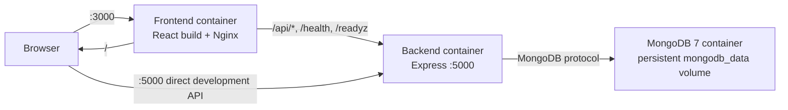
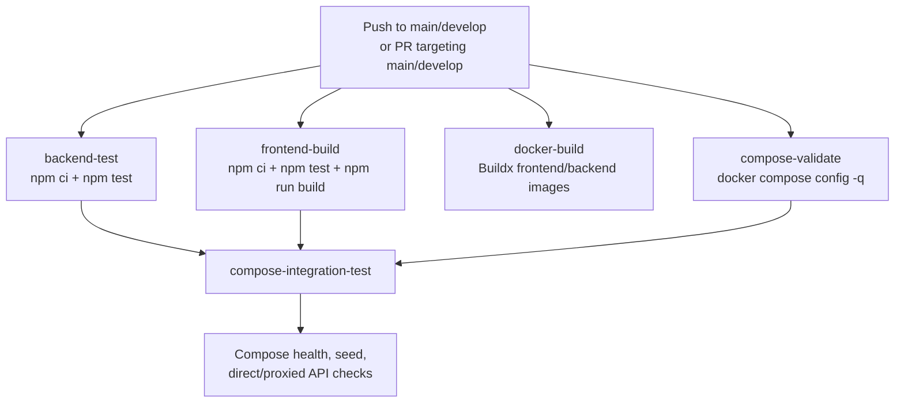
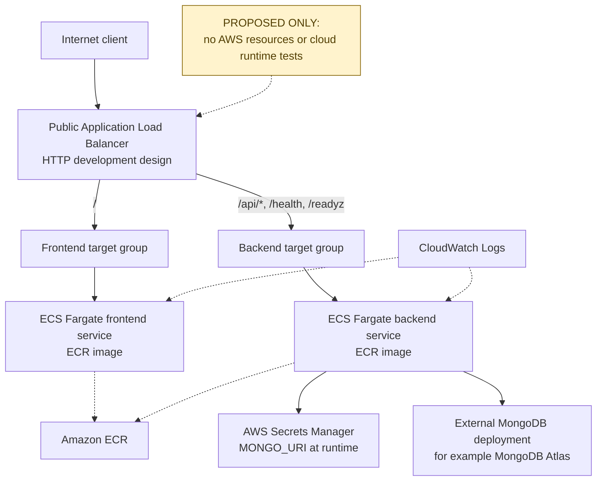

# Multi-Cloud CI/CD System for Smart Education Platforms

Milestone 3 implementation for the CIS 2026 project. The repository contains
a working MERN Smart Education Platform, Docker Compose orchestration, a
five-job GitHub Actions CI workflow, and an AWS development Terraform
configuration. Local application and infrastructure configuration checks are
implemented and reproducible. Cloud provisioning, authenticated cloud plans,
and Kubernetes deployment have **not** been performed.

## 1. Implemented scope

- **Frontend:** React/Vite dashboard served by Nginx in the production image.
- **Backend:** Express REST API with Mongoose, validation, CORS, liveness, and
  database-readiness checks.
- **Database:** MongoDB, supplied locally through Docker Compose or an external
  managed deployment for future cloud use.
- **Local orchestration:** Docker Compose services for MongoDB, backend, and
  frontend/Nginx.
- **CI:** GitHub Actions jobs for backend tests, frontend tests/build, Docker
  image builds, Compose validation, and Compose integration tests.
- **Terraform foundation:** Independent AWS development root with reusable ECR,
  networking, ECS/Fargate, ALB, IAM, and CloudWatch modules; independent Azure
  development foundation.
- **Not completed:** AWS/Azure provisioning, remote state bootstrap, cloud
  runtime testing, Kubernetes manifests/clusters, and public deployment.

## 2. Architecture

### Application and Docker Compose



Compose starts MongoDB first, waits for backend readiness, and then starts the
frontend. Production frontend requests use the same-origin `/api` path;
development Vite can use `VITE_API_BASE_URL=http://localhost:5000`.

### GitHub Actions CI



The workflow does not push images, use cloud credentials, or provision
resources.

### Proposed AWS ECS architecture — not deployed



The AWS development default uses public ECS task subnets and no NAT gateway
to reduce development cost. Private tasks require NAT or a separately
implemented VPC-endpoint design, DNS support, image-pull access, log delivery,
secret retrieval, and external MongoDB connectivity.

## 3. Local setup

Requirements: Node.js 22+, npm, Docker Desktop, and Docker Compose.

### Without Docker

```powershell
cd backend
Copy-Item .env.example .env
npm ci

cd ..\frontend
Copy-Item .env.example .env
npm ci
```

Set `MONGO_URI` in `backend/.env`, then use separate terminals:

```powershell
cd backend
npm start
```

```powershell
cd frontend
npm run dev
```

Optional idempotent course seed:

```powershell
cd backend
npm run seed
```

### Docker Compose

```powershell
docker compose up -d --build --wait --wait-timeout 120
docker compose ps
docker compose exec -T backend npm run seed
```

Endpoints:

- Frontend: <http://localhost:3000>
- Direct backend courses: <http://localhost:5000/api/courses>
- Direct backend liveness: <http://localhost:5000/health>
- Direct backend readiness: <http://localhost:5000/readyz>
- Frontend-proxied API and health paths use port 3000.

Stop while preserving data:

```powershell
docker compose down
```

Stop and remove the local database volume:

```powershell
docker compose down -v
```

## 4. API and readiness behavior

| Method | Endpoint | Behavior |
| --- | --- | --- |
| GET | `/health` | Lightweight liveness response with HTTP 200 |
| GET | `/readyz` | HTTP 200 only when MongoDB is connected; otherwise HTTP 503 |
| GET | `/api/courses` | Lists courses; HTTP 503 while MongoDB is unavailable |
| GET | `/api/courses/:id` | Returns a course or HTTP 404 |
| POST | `/api/courses` | Validates and creates a course; HTTP 400 for invalid data |

## 5. Continuous integration

The workflow is [`.github/workflows/ci.yml`](./.github/workflows/ci.yml) and
runs on pushes to `main`/`develop` and pull requests targeting those branches.
It contains five jobs:

1. `backend-test`
2. `frontend-build`
3. `docker-build`
4. `compose-validate`
5. `compose-integration-test`

Node.js 22, both committed npm lockfiles, `npm ci`, Docker Buildx, and
GitHub-hosted Ubuntu runners are used. No registry push or cloud deployment is
performed by the workflow.

## 6. Terraform status

Terraform files are under [`infra/terraform/`](./infra/terraform/):

- [`aws/dev/`](./infra/terraform/aws/dev/) composes ECR, VPC networking,
  ECS/Fargate services, ALB routes, IAM, and CloudWatch modules.
- [`azure/dev/`](./infra/terraform/azure/dev/) is an independent Azure
  provider/state foundation and does not provision Azure resources yet.
- [`modules/aws/`](./infra/terraform/modules/aws/) contains reusable AWS
  modules.

Terraform validation uses `terraform init -backend=false`, so it does not
contact the declared S3/Azure remote backends. Provider lockfiles are retained
for AWS provider 5.100.0 and AzureRM provider 4.81.0.

Before any cloud deployment, a reviewed environment must provide:

- Authenticated access to the intended cloud account.
- Secure remote state storage and locking.
- Frontend and backend images published to ECR.
- An AWS Secrets Manager secret containing `MONGO_URI`.
- A reachable MongoDB deployment and approved network access.
- A decision about public development tasks versus private tasks with NAT or
  suitable VPC endpoints.
- HTTPS/ACM design for any non-local or production exposure.

No credentials, database URI, local `.tfvars`, Terraform state, or provider
authentication are stored in the repository.

## 7. Milestone 3 rubric-to-evidence matrix

| Rubric criterion | Evidence in this repository | Verified status |
| --- | --- | --- |
| 1. Methodological Planning and Alignment | Project architecture, local/cloud scope, Terraform separation, cost/state/security notes, implementation history | Local scope and plan documented; cloud alignment remains proposed |
| 2. Implementation and Technical Soundness | MERN source, readiness behavior, Dockerfiles, Compose, tests, CI workflow, AWS modules | Local application and configuration checks verified; cloud runtime untested |
| 3. Resource and Tool Utilization | Node/npm lockfiles, Docker, MongoDB, Compose, GitHub Actions, Terraform provider lockfiles | Tools used and local checks reproducible |
| 4. Design Alternatives and Choice of Approach | Compose versus direct local execution; ECS Fargate versus Kubernetes; public tasks versus private tasks/NAT; AWS/Azure root separation | Rationale documented; alternatives not experimentally compared |
| 5. Workflow Clarity and Documentation | README commands, CI jobs, diagrams, API table, Terraform README, cleanup and prerequisite notes | Reproduction workflow documented; screenshots and pipeline timing evidence still needed |

## 8. Acceptance criteria

The current Milestone 3 acceptance criteria are:

- Backend tests pass without requiring a manually started HTTP server.
- Frontend URL tests pass and the production build succeeds.
- Docker Compose configuration validates.
- Compose starts healthy MongoDB, backend, and frontend services.
- `/health`, `/readyz`, direct course API, and frontend-proxied course API work
  in the Compose integration path.
- CI defines separate reproducible test/build/container/orchestration checks.
- Terraform AWS and Azure roots format and validate without cloud access.
- Secrets, state, local variable files, and generated artifacts are excluded.
- Cloud deployment and Kubernetes work are explicitly identified as future work,
  not claimed as completed evidence.

## 9. Verified validation evidence

The following checks were executed in the current workspace:

| Check | Command | Result |
| --- | --- | --- |
| Backend tests | `Set-Location .\backend; npm test` | 6 passed, 0 failed; 696.2951 ms reported by Node |
| Frontend tests | `Set-Location .\frontend; npm test` | 3 passed, 0 failed; 80.5675 ms reported by Node |
| Frontend production build | `Set-Location .\frontend; npm run build` | Passed; Vite reported 541 ms |
| Compose config | `docker compose config -q` | Passed |
| Compose integration | `docker compose up ...`; health, seed, direct/proxied API checks; `docker compose down -v` | Passed |
| Terraform formatting | Docker Terraform 1.9.8 `fmt -check -recursive` | Passed |
| AWS validation | Docker Terraform 1.9.8 `init -backend=false && validate` | Passed |
| Azure validation | Docker Terraform 1.9.8 `init -backend=false && validate` | Passed |
| Git whitespace | `git diff --check` | Passed |

The repository does not contain a GitHub Actions run ID, job log, or timing
artifact, so exact hosted pipeline timings are not available and are not
claimed here.

## 10. Limitations and untested prerequisites

- No AWS or Azure account was authenticated.
- No Terraform `apply`, `destroy`, remote-state bootstrap, or cloud resource
  provisioning was run.
- No ECS task startup, ECR image pull, ALB routing, IAM permission, CloudWatch
  delivery, Secrets Manager retrieval, or cloud MongoDB connectivity was tested.
- Azure resource modules are not implemented.
- Kubernetes manifests, clusters, and Kubernetes CI checks are not implemented.
- HTTPS certificate/DNS validation is not implemented in the development ALB.
- Performance, scalability, cost, deployment duration, and multi-cloud
  equivalence measurements are not available.
- The default AWS public-task/no-NAT configuration is a documented development
  cost trade-off, not a production security recommendation.

## 11. Evidence still needed for submission

Within the remaining 2–3 days, prioritize:

1. Capture screenshots of the populated dashboard, Compose health, and API
   responses.
2. Capture a GitHub Actions run showing all five jobs passing.
3. Record the GitHub Actions run URL and job durations; do not infer them from
   local timings.
4. Add a short report section explaining why ECS Fargate was selected initially
   and why Kubernetes remains future work.
5. Add the three diagrams above to the final report or presentation.
6. Review and commit the Terraform tree only after confirming the exact
   intended files and secrets scan.
7. Keep cloud deployment as future work unless there is sufficient time for a
   separately approved, authenticated, cost-controlled experiment.

## 12. Files that should be committed

The current worktree contains the application/CI commits plus an uncommitted
Terraform tree. The Terraform files to review and commit are:

```text
infra/terraform/.gitignore
infra/terraform/README.md
infra/terraform/aws/dev/.terraform.lock.hcl
infra/terraform/aws/dev/backend.tf
infra/terraform/aws/dev/dev.tfvars.example
infra/terraform/aws/dev/main.tf
infra/terraform/aws/dev/outputs.tf
infra/terraform/aws/dev/providers.tf
infra/terraform/aws/dev/variables.tf
infra/terraform/aws/dev/versions.tf
infra/terraform/azure/dev/.terraform.lock.hcl
infra/terraform/azure/dev/backend.tf
infra/terraform/azure/dev/dev.tfvars.example
infra/terraform/azure/dev/main.tf
infra/terraform/azure/dev/outputs.tf
infra/terraform/azure/dev/providers.tf
infra/terraform/azure/dev/variables.tf
infra/terraform/azure/dev/versions.tf
infra/terraform/modules/aws/README.md
infra/terraform/modules/aws/alb/main.tf
infra/terraform/modules/aws/alb/outputs.tf
infra/terraform/modules/aws/alb/variables.tf
infra/terraform/modules/aws/ecr/main.tf
infra/terraform/modules/aws/ecr/outputs.tf
infra/terraform/modules/aws/ecr/variables.tf
infra/terraform/modules/aws/ecs-cluster/main.tf
infra/terraform/modules/aws/ecs-cluster/outputs.tf
infra/terraform/modules/aws/ecs-cluster/variables.tf
infra/terraform/modules/aws/ecs-service/main.tf
infra/terraform/modules/aws/ecs-service/outputs.tf
infra/terraform/modules/aws/ecs-service/variables.tf
infra/terraform/modules/aws/logging/main.tf
infra/terraform/modules/aws/logging/outputs.tf
infra/terraform/modules/aws/logging/variables.tf
infra/terraform/modules/aws/network/main.tf
infra/terraform/modules/aws/network/outputs.tf
infra/terraform/modules/aws/network/variables.tf
infra/terraform/modules/azure/README.md
```

Do not commit `backend/.env`, local frontend `.env` files, `dist/`,
`.terraform/`, `*.tfstate`, local `*.tfvars`, credentials, or database
connection strings. The root and Terraform-specific ignore rules cover these
patterns, with only `*.tfvars.example` permitted.

## 13. Future work

The next deployment phase may implement an authenticated, reviewed AWS
experiment, then an equivalent Azure Container Apps or Kubernetes comparison.
Those activities require separate evidence for deployment success, cost,
timing, scalability, cleanup, and manual intervention. They are not part of
the verified Milestone 3 results in this repository.
